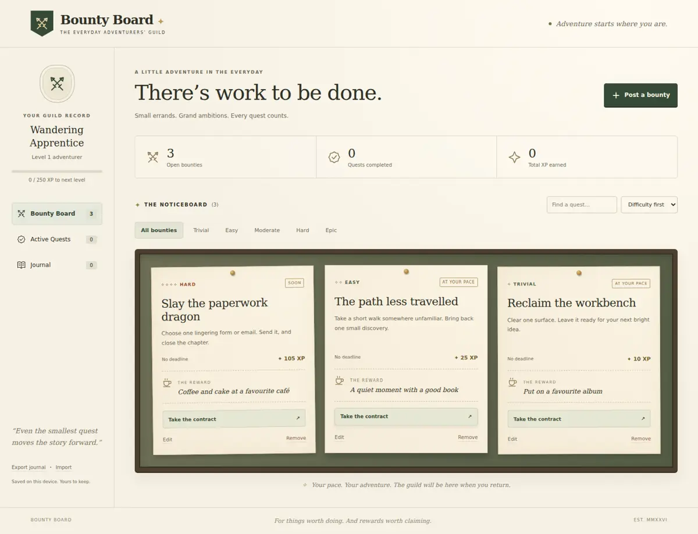

# Bounty Board

A little adventure in the everyday. A cosy RPG noticeboard for real-life tasks, built with **HTML, CSS, and vanilla JavaScript**. No libraries, build step, external fonts, trackers, or backend.



## Run

Open `index.html` in a modern browser, or serve this directory for a consistent storage origin:

```sh
python -m http.server 8080
```

Visit `http://localhost:8080`. Any static host, including GitHub Pages, can serve these files unchanged. For GitHub Pages after merging: select **Settings → Pages → Deploy from a branch → main → / (root)**. No hosting configuration is changed by this implementation.

## Your first adventure

1. Post a bounty with a title, completion description, difficulty, urgency, optional due date, and self-assigned reward.
2. Take the contract to move it into **Active Quests**.
3. Complete it, write an optional reflection, and claim the bounty.
4. Browse completed quests in the **Journal**, searchable by title, description, reward, or reflection.

The board starts empty. You can explicitly load three examples and edit or remove them. Search, difficulty filters, and sorting work in all three views. Active contracts can be returned to the board, and unfinished contracts can be edited or removed. Removal asks for confirmation; removal and completion offer an immediate Undo action until the next notification or reload.

## XP and rewards

| Difficulty | Base XP |
| ---------- | ------: |
| Trivial    |      10 |
| Easy       |      25 |
| Moderate   |      50 |
| Hard       |     100 |
| Epic       |     200 |

Routine / Soon / Urgent add **0 / 5 / 10 XP** respectively. A bounty's payout does not increase as its deadline approaches. Explicitly editing its difficulty or urgency recalculates the payout before completion. Every **250 XP** earns a level; titles change every three levels. XP is derived from completed journal entries, so reloading cannot award it twice. Rewards are your own promises, recorded as text; the app does not purchase, restrict, or automatically grant anything.

## Data and privacy

- Records are stored in `localStorage` under `bounty-board.v1`. There are no accounts, cloud sync, analytics, or network requests.
- Records belong to the browser profile and origin. Private browsing, clearing site data, changing host/port, or moving between a local file and a hosted site may remove or separate records. **Export a backup before changing where you run the app.**
- Use **Export journal** for a JSON backup and **Import** to restore one. Import replaces the current record only after validation and confirmation. Export first to retain the old record.
- Invalid imports are rejected without changing existing data. The first version accepts up to 3,000 bounties and backups up to 2 MB.
- Storage write failures show a persistent warning; the current session remains usable so you can export. Unreadable existing records pause changes to avoid overwriting them; export a recovery copy, then import a valid backup.
- Tabs on the same origin observe one another's saves. Simultaneous edits are last-write-wins; this is a personal, single-device tool.

## Implementation

- `index.html`: explicit semantic interface, forms, native dialogs, SVG symbols, and an HTML `<template>` for repeated bounty cards.
- `styles.css`: responsive layouts, CSS-only textures, notice animations, completion stamps, level celebrations, and reduced-motion support.
- `app.js`: event handling, template cloning, safe `textContent` updates, validation, persistence, and JSON backup handling. No `innerHTML`, `eval`, or HTML-string injection.
- `favicon.svg`: local guild emblem.

Keyboard focus states, labelled forms, live announcements, native modal focus management, and text labels for difficulty/urgency are included. Decorative icons supplement labels. The app works without network access once its files are available; this version has no service worker or installable PWA shell.

## Browser smoke test

`tests/smoke.cjs` exercises real interactions with Playwright and Node's built-in assertions. Playwright is a separate developer tool; nothing is shipped to users or imported by the app.

With Playwright installed in a separate tooling directory and Chromium available:

```sh
PLAYWRIGHT_MODULE=/absolute/path/to/playwright CHROMIUM_EXECUTABLE_PATH=/absolute/path/to/chromium node tests/smoke.cjs
```

The script starts and stops its own local server, uses disposable browser contexts, and writes screenshots only when `SCREENSHOT_DIR` is set.
